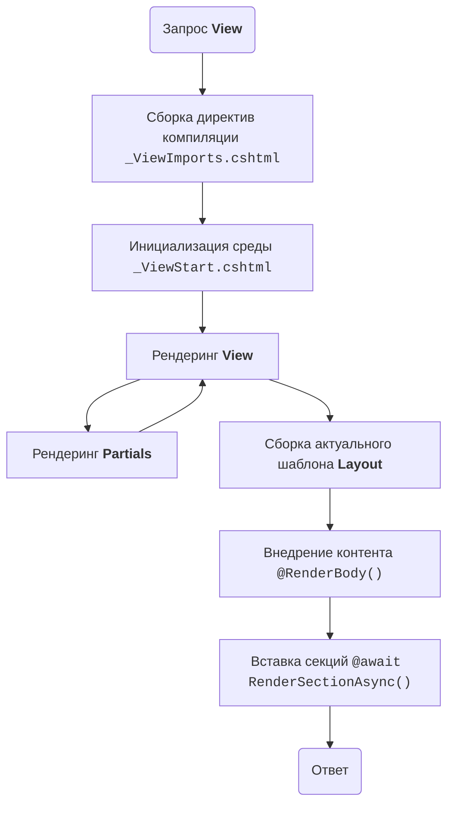

# Анатомия и жизненный цикл рендеринга представлений (Razor View Lifecycle)

Рендеринг интерфейса в нашем фреймворке базируется на движке **Razor (ASP.NET Core MVC / .NET 10)**. Процесс сборки финального HTML-документа детерминирован и проходит через строго последовательные этапы инициализации, компиляции контекста, выполнения контентной части и контейнеризации в глобальный макет.

---

## Модули компонентов отображения


### 1. Конфигуратор окружения (`_ViewImports.cshtml`)
Этот файл отвечает за глобальную настройку пространства имен и компиляции для всех Razor-представлений в текущем каталоге и его подпапках. Он автоматически мёржится движком с целевым `.cshtml` файлом перед его выполнением.

**Ключевое назначение:**
* **Глобальный импорт типов:** Избавляет от необходимости прописывать полные CLR-пути к моделям и DTO на каждой странице.
* **Регистрация компонентов разметки:** Подключает системные и кастомные Tag Helpers (компоненты вашего фреймворка).
* **Внедрение инфраструктуры:** Позволяет через `@inject` прокинуть сервисы CMS (например, локализацию или конфигурацию) напрямую в слой отображения.


### 2. Инициализатор среды (`_ViewStart.cshtml`)
Файл инициализации, код внутри которого выполняется *в самый первый момент* после того, как движок Razor нашел целевое представление, но до того, как начнется рендеринг его разметки.

**Ключевое назначение:**
* **Определение мастер-страницы:** Задает дефолтный макет (`Layout`) для группы представлений.
* **Динамическая конфигурация среды:** Позволяет выполнять C#-логику на этапе старта. Например, здесь можно переключать темы оформления на основе контекста HTTP-запроса или настроек пользователя в .NET 10.


### 3. Шаблон мастер-страницы (`_Layout.cshtml`)
Центральный визуальный шаблон (Master Page), определяющий общую анатомию HTML-документа сайта (`<!DOCTYPE html>`, `<html>`, `<head>`, `<body>`), а также точки подключения глобальных стилей и скриптов.

**Ключевое назначение:**
* **Инъекция контента:** Предоставляет метод `@RenderBody()` — строго обязательную точку, куда движок вшивает сгенерированный HTML-код контентного представления.
* **Именованные зоны (`@RenderSection`):** Места для динамического вывода изолированных скриптов или стилей, которые были объявлены внутри контентных страниц.


### 4. Частичные представления (Partial Views)
Вспомогательные файлы Razor без собственного макета (`Layout = null`), инкапсулирующие в себе переиспользуемые фрагменты разметки и логики отображения.

**Ключевое назначение:**
* **Декомпозиция тяжелого интерфейса:** Позволяют разделять монолитные `.cshtml` файлы на поддерживаемые логические блоки.
* **Изолированный контекст данных:** Принимают строго типизированную модель (`@model`), но по умолчанию имеют доступ и к родительскому словарю `ViewData`.
* **Асинхронный вывод:** В .NET 10 рендерятся через неблокирующий тег `<partial name="..." />` прямо в общий поток ответа.


### 5. Контентное представление (View)
Конечная точка назначения механизма *View Discovery*, вызываемая из метода действия контроллера (`return View(model);`). 

**Ключевое назначение:**
* **Реализация паттерна MVC:** Отвечает исключительно за генерацию UI на основе полученной и строго типизированной ViewModel.
* **Смешанный синтаксис:** Использует синтаксис Razor (`@`) для декларативного внедрения управляющих конструкций (циклы, условия, pattern matching из C# 14) в HTML-код.

---


## Пошаговый жизненный цикл сборки (Execution Timeline)

Как только контроллер передает управление слою представления, движок Razor выполняет рендеринг по следующему упорядоченному алгоритму:


### Шаг 1. Сборка директив компиляции (`_ViewImports`)
Движок рекурсивно поднимается от папки запрошенного представления к корню приложения, находит все файлы `_ViewImports.cshtml` и формирует единый заголовочный контекст для компилятора. Кэшированные сборки применяют директивы в следующем порядке:
1. `@using` и `@namespace` — определение области видимости типов.
2. `@addTagHelper` / `@removeTagHelper` — инициализация парсеров тегов.
3. `@inject` — разрешение зависимостей из DI-контейнера .NET 10.
4. `@model` и `@inherits` — определение базового класса генерируемой страницы.


### Шаг 2. Исполнение пред-настроек (`_ViewStart`)
Запускается выполнение императивного C#-кода во всех найденных файлах `_ViewStart.cshtml` (от корня к целевой папке). На этом этапе в контекст выполнения записывается путь к базовому макету:
```csharp
@{
    Layout = "_Layout";
}
```
Так же, может инициализировать другие настройки и переменные среды или переопределять их ранее установленные значения.

**Не может содержать элементы html- и razor-разметки (она игнорируется)!**


### Шаг 3. Рендеринг основного представления и компонентов
Начинается построчное выполнение кода целевого `*.cshtml` файла:
1. Вычисляются все C#-выражения, генерируя текстовые фрагменты HTML.
2. При вызове частичных представлений (`<partial>`) или компонентов (`ViewComponent`) выполнение родительской страницы приостанавливается. Движок изолированно рендерит вложенный компонент, сбрасывает его HTML в общий поток вывода и возвращает управление родителю.
3. Объявленные блоки `@section Name { ... }` не выводятся на экран сразу, а упаковываются во временный буфер памяти (`ViewContext`).
4. **Итог шага:** Сформированный HTML-код контента страницы сохраняется в буфер ответа.


### Шаг 4. Сборка финального Layout-контейнера
Управление переходит к файлу, путь к которому был зафиксирован в свойстве `Layout` на Шаге 2 (или переопределен на Шаге 3).
1. Движок рендерит общую разметку макета.
2. При достижении инструкции `@RenderBody()` берется готовый HTML-буфер из Шага 3 и стримится внутрь макета.
3. При достижении `@RenderSection("Name")` движок извлекает из словаря памяти куски кода (например, JavaScript), отложенные контентной страницей, и рендерит их в целевой точке макета.
4. Полностью агрегированный HTML-пакет передается в поток `HttpContext.Response.Body` и отправляется клиенту.


## Схема конвейера рендеринга (Render Pipeline)


